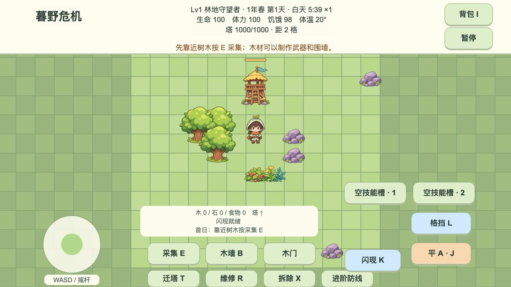

# 暮野危机（暂名）

基于 Cocos Creator 3.8.8 / TypeScript 的微信单机 2D 生存游戏，当前交付为包含成长、防线、装备与四季规则的本地试玩版。

## 本地试玩

本机已有构建时，直接打开 <http://127.0.0.1:7457/>；预览服务未运行时执行 `npm run serve`。主菜单可打开“玩法手册”。完整路线和验证范围见 [本地试玩交付](docs/local-playtest-delivery.md)。

从源码重新构建：

```sh
npm ci
npm run build:web
npm run serve
```

打开 http://127.0.0.1:7457 ，点击“新的旅程”或“继续游戏”。WASD／方向键移动，J／空格攻击，K 闪现，按住 L 格挡，Esc 暂停；也提供触屏摇杆和动作按钮。

已实现基础战斗、采集、白装制造与五槽穿戴、饥饿、昼夜、木墙／门、夜袭守塔、白天迁塔、维修、死亡装备永久损失、复活、塔毁终局与本地存档。E 采集，I 背包，B 建墙，T 迁塔，R 维修，F 吃食物。暂停菜单可开 ×4 快速试玩。

已加入守望者／猎手天赋、战斗升级、三类采集成长和高级工具，3／6 级各可在塔旁学习一种技能，横扫／冲击波／战吼／急救四选二，1／2 键使用，本局不可改选。三类围墙、快速与攻城敌人、五部位×四稀有度共 20 个装备模板、精英保底、四季温度与燃料设施、季末首领已接入。

围墙按上下左右相邻格自动连接，支持竖墙、转角与闭合营地，木门随相邻墙方向显示。建造时绿格可放置，按住调整落点、松手建造，“完成建造”或 Esc 退出；斜角不连接，留门供角色进出。已有存档无需迁移，详见 [围墙修复验证](docs/wall-connections-20261120.md)。

当前为亮色 Q 版：两个角色、全部怪物和营地使用统一卡通图集；四季、昼夜和迷雾使用不同的方格地表配色。短音效、游戏规则和存档版本保持不变。Android／iPhone 真机、30 分钟性能及完整正常节奏验收尚未完成，不能视为可发布成品。存档版本为 3，兼容读取版本 1／2。

新界面：按 I 打开图标背包，点选装备、材料、配方或工具查看详情。点头像或按 P 查看人物和采集成长。塔旁行囊的“营地训练”支持技能图卡，点战斗栏或按 1／2 放技能。需要直接体验装备和训练时，可打开[隔离界面样本](http://127.0.0.1:7457/?qa=interface)，不会写正式存档。

## 验证与构建

```sh
npm test
npm run typecheck
npm run build:wechat
```

构建需要本机安装 Creator 3.8.8；自定义安装位置可设置 `COCOS_CREATOR_BIN`。首次检出先用编辑器打开或构建，生成类型声明后再运行类型检查。两种构建命令都会执行实际转译产物的碰撞、采集、制造、穿戴与存档恢复检查。

微信包输出到 `build/wechatgame`，AppID 为用户提供的 `wx316c8e0d7d10297a`。微信构建采用压缩脚本并生成四个本地资源分包，构建后自动检查 AppID、主包大小与分包清单。真机预览需要该账号确实属于小游戏且登录微信有开发权限。具体见[微信预览准备](docs/wechat-preview-20261119.md)。

- [环境与验证记录](docs/development.md)
- [首夜试玩说明与验证边界](docs/first-night-playtest.md)
- [双角色与成长说明](docs/progression-playtest.md)
- [防线、装备、四季试玩](docs/seasons-defense-playtest.md)
- [四季常速关键节点验证](docs/season-checkpoints-20261117.md)
- [死亡、装备恢复与塔毁验证](docs/outcomes-playtest-20261117.md)
- [规格与证据对应清单](docs/verification-matrix.md)
- [本轮审核结论](docs/implementation-review.md)
- [资源重载与内存观测](docs/resource-observation.md)
- [40 敌人桌面性能基线](docs/performance-baseline-20261117.md)
- [验收补测及微信真机矩阵](docs/acceptance-20261118.md)
- [早期战斗体感待确认清单](docs/combat-playtest.md)
- [OpenSpec 任务进度](openspec/changes/build-single-player-survival-defense/tasks.md)


