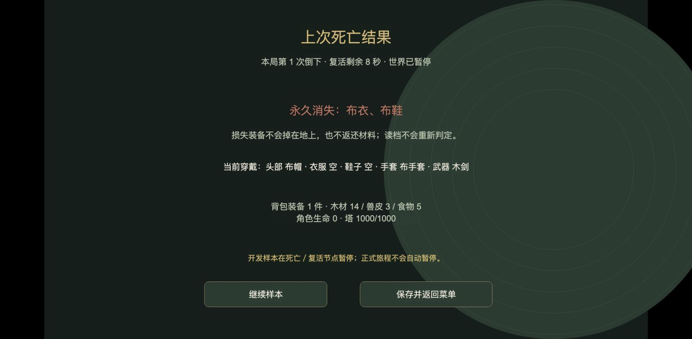

# 死亡、装备恢复与塔毁结算验证

日期：2026-11-17。环境：macOS 桌面 Chrome，Cocos Creator 3.8.8 Web Mobile 实际构建。

## 本轮改动

背包新增“上次死亡损失”入口，显示最近一次死亡的永久损失、当前穿戴、背包装备数量、材料、角色和塔生命。死亡提示消失或刷新后仍能回看；仅记录最近一次死亡，不冒充全部死亡历史。沿用原有存档字段，没有升级存档版本。

## 独立样本与实际操作

打开 http://127.0.0.1:7457/?qa=outcomes 。仅本机 localhost / 127.0.0.1 启用该开发入口。底部“重置为死亡样本”和“重置为塔毁样本”会替换该入口自己的测试旅程；正式旅程仍使用原键，样本通过 qa-outcomes/ 前缀隔离读写。刷新可恢复测试进度，不自动清理正常存档。

样本使用默认概率及敌人参数、固定种子 7，预先制造穿戴五件白装并保留一把背包木剑，提供少量基础材料；死亡样本把角色初始生命设为 1，塔毁样本把塔初始生命设为 1。结果由正常敌人 AI 攻击触发，没有直接调用死亡或塔毁结算。它们验证指定节点，不能代替从空手开始的完整生存流程或全年平衡。

死亡样本在首次死亡和复活节点暂停，以便观察；这个自动暂停仅用于开发样本，正式旅程死亡期间世界继续运行。

| 实际操作 | 已观察结果 |
| --- | --- |
| 启动死亡样本，等待近战怪攻击 | 第一次倒下，布衣与布鞋永久消失；帽、手套、木剑保留；背包木剑与 14 木、3 兽皮、5 食物保留，塔 1000/1000 |
| 死亡节点保存返回菜单、刷新、继续、打开背包和损失页 | 仍为第一次死亡，同样两件损失，复活剩余约 8 秒，无重掷或返还 |
| 返回场景，等待复活并移动，再打开背包 | 角色恢复 100 生命，死亡次数仍为 1，塔生命未增加，原损失仍在 |
| 回到塔旁，消耗 3 兽皮制造布衣并穿戴 | 衣服槽恢复，兽皮耗尽，鞋子槽仍空；背包备用木剑保留。是新制造装备，不是返还死亡物品 |
| 启动塔毁样本，等待攻城怪攻击 | 进入“营地塔已被摧毁”结算，保留本局统计 |
| 终局返回菜单、刷新 | 入口变为“查看上局结算” |
| 点击查看结算并按攻击键 J | 保持结算界面，不恢复存活塔或进入战斗 |

浏览器仅通过菜单、按键与画面操作；没有注入或修改页面内部游戏状态。

## 画面证据

- [刷新后损失一致](screenshots/death-restored-20261117.png)
- [复活后未返还装备](screenshots/respawn-loss-20261117.png)
- [补制布衣并穿戴](screenshots/death-recraft-20261117.png)
- [攻城怪摧塔结算](screenshots/tower-ended-20261117.png)
- [刷新后仅可查看结算](screenshots/tower-ended-menu-20261117.png)
- [恢复仍为终局](screenshots/tower-ended-restored-20261117.png)

## 检查与剩余边界

101 项 Node 测试、类型检查、OpenSpec 严格校验通过。两平台构建通过；scripts/check-build.mjs 新增实际转译产物的敌人攻击、五槽损失、独立存储和攻城塔毁检查，两平台均通过。

微信开发者工具当前能载入同一构建，调试器为 0 错误、1 条 shading scale 警告；本轮切独立模拟器后点击及键盘继续仍未取得有效响应，未确认是工具输入投递、模拟器状态还是游戏适配问题。未完成微信制造／文件重启恢复，不用浏览器证据替代。

当前任务总进度仍为 46/55。6.6、8.1 仍需要用户试玩反馈，4.12 还包含真机迁塔与首夜节奏，8.7 还包含完整一年端到端与其他阶段验收，因此本轮不额外勾选这些复合任务。
