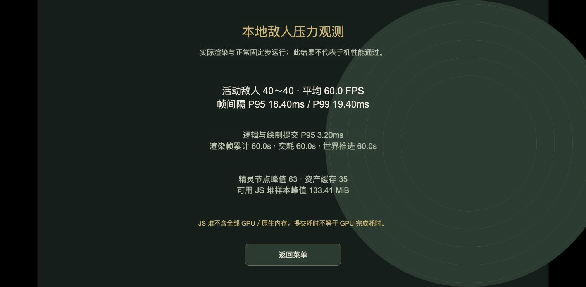

# 40 敌人桌面性能基线

日期：2026-11-17。本记录是任务 8.4 的本地预检，不是 Android／iPhone 30 分钟验收。

## 环境与场景

| 项目 | 实测环境 |
| --- | --- |
| 系统／处理器／内存 | macOS 26.6.2，Apple M5，24 GiB |
| 浏览器／引擎 | Chrome 157.0.8103.79，Cocos Creator 3.8.8 |
| Web 视口 | 1512×742，游戏设计分辨率 1280×720 |
| 入口 | http://127.0.0.1:7457/?qa=performance |
| 负载 | 正式配置 40 个活动敌人，混合非精英类型，从塔周边合法位置出生，保留正常 AI、碰撞、攻击、死亡复活及存档提交 |
| 调整 | 塔生命与上限仅在该开发样本提高至 1000000，避免一分钟内提前终局；起始普通波次预算置零，预先揭示出生附近区域，保证可观察负载 |
| 存储／速度 | 独立内存存储，不访问正式存档；1×游戏速度，不缩短游戏日长 |

点“60 秒敌人压力观测”，保持前台且不操作。样本会运行正常场景后显示结果。帧间隔使用 performance.now 的连续 update 回调间隔，避免把引擎可能截断的 delta 当成全部真实时间；结果是主线程帧频观测，不是 GPU 完成时间测量。

## 实际浏览器结果

| 指标 | 结果 |
| --- | --- |
| 活动敌人范围 | 40～40 |
| 回调帧数／累计间隔 | 3599 / 60.009 秒 |
| 实耗／世界推进 | 60.036 / 59.967 秒 |
| 平均帧率 | 59.97 FPS |
| 帧间隔 P95／P99 | 18.40 / 19.40 ms |
| 本组件逻辑与绘制提交 P95 | 3.20 ms |
| 精灵节点峰值（使用中加池内） | 63 |
| 资产缓存峰值 | 35 |
| 可用 JS 堆样本峰值 | 133.41 MiB |

测量保持 40 个存活敌人且没有提前结束，没有发现本轮桌面主线程明显超出 30 FPS 所需帧预算的情况，因此没有为追求指标额外修改寻路规则或降低负载。

JS 堆不含全部 GPU／原生内存，也不是进程峰值内存；一分钟采样不能证明无泄漏或 30 分钟稳定。瞬时慢帧仍需在手机与更长场景观察。敌群集中攻击塔时存在明显视觉堆叠，保留为夜间辨识度与遮挡体验的待验项，不因帧率达标而通过美术验收。

[40 敌人运行画面](screenshots/enemy-load-20261117.png) · [控制台原始记录](evidence/enemy-performance-20261117.json)

## 无渲染领域基线

执行 `npm run benchmark:domain`，使用同一场景、正式步长 1/30 秒运行 1800 tick，输出 JSON。它不加载渲染引擎、不包含浏览器绘制或平台存储，不报告 FPS。

本次 Node v26.10.0 结果：tick P95 1.159 ms、P99 2.044 ms、最大 4.014 ms；末尾仍 40 个存活敌人、未终局。详见 [原始结果](evidence/enemy-domain-20261117.json)。时钟采样和宿主调度存在波动，不用该值直接推算手机帧率。

## 检查与未完成门槛

103 项测试覆盖负载场景合法性、数量与配置不变，以及帧率按实际时间计算、慢帧分位和负载范围。类型检查与两平台构建通过，实际转译产物再次校验压力样本达到配置上限。五组资源加载、已有死亡与终局回归继续通过。

仍需选定 Android／iPhone，记录微信版本、普通／iOS 高性能模式、40 敌人 30 分钟、帧率、进程峰值内存及后台恢复。当前没有这些设备证据，任务 8.4／8.5 继续未完成，总进度仍为 46/55。
