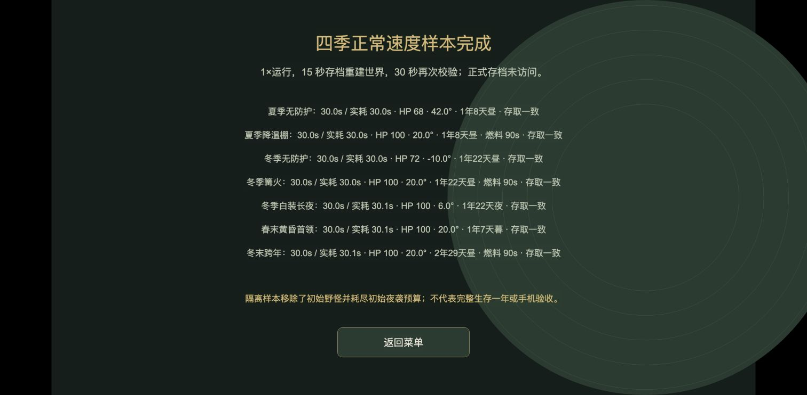

# 四季常速关键节点验证

日期：2026-11-17。Cocos Creator 3.8.8，macOS 桌面 Chrome，Web Mobile 实际构建。

## 方法与范围

打开本地 `/?qa=seasons`，点击“四季常速验证”。七个预设起点各运行约 30 秒游戏时间，速度固定 1×，渲染与 30Hz 固定步使用正常入口；不缩短日长或季节长度。第 15 秒通过 Session / SaveStore 提交并读回、校验完整快照，重新构造世界继续运行；第 30 秒再校验一次。浏览器控制只点击入口、观察画面和读取控制台结果，没有修改页面内部游戏状态。

该页面从启动起使用独立内存存储，正式 localStorage / 微信文件存储不被访问。预设起点会移除初始野怪、将起始当夜普通夜袭预算置零，提供基础材料及对应设施／白装，隔离观察环境、事件与边界。春末首领仍按正常规则生成和攻击；样本不代表自然成长到该节点或完整一年生存成功。

## 实测结果

| 样本 | 游戏 / 实耗 | 最终生命 / 体温 | 额外观察 |
| --- | --- | --- | --- |
| 夏季无防护 | 30.0 / 30.0 秒 | 68 / 42.0° | 高温按间隔扣血 |
| 夏季降温棚 | 30.0 / 30.0 秒 | 100 / 20.0° | 剩余燃料约 90 秒 |
| 冬季无防护 | 30.0 / 30.0 秒 | 72 / -10.0° | 从 20° 按正常速率降低并开始扣血 |
| 冬季篝火 | 30.0 / 30.0 秒 | 100 / 20.0° | 剩余燃料约 90 秒 |
| 冬夜四件白装 | 30.0 / 30.1 秒 | 100 / 6.0° | 长夜倒计时从 4:00 正常推进，存取不重置 |
| 春末黄昏首领 | 30.0 / 30.1 秒 | 100 / 20.0° | 首领保持 spawned，角色倒下 1 次后复活；塔剩 820；满血不表示未受伤 |
| 冬末跨年 | 30.0 / 30.1 秒 | 100 / 20.0° | 进入第二年春季第 29 天，篝火保留且剩余燃料约 90 秒；冬季首领记为 missed |

七段样本中途与末尾快照均一致；[原始控制台结果](evidence/seasons-normal-20261117.json)包含首领事件、塔生命和死亡次数。

## 死亡后的可恢复路线

新增 season-playtest.test.ts 在夏／冬分别将死亡损失率设为 100%，用温度触发角色死亡，确认全部穿戴消失、营地设施及背包材料保留。按正常 1/30 秒步进经过复活，补充对应设施燃料后再运行 60 秒，生命保持满值、没有第二次死亡、体温处于安全范围。

这是“提前建设营地、保留基础燃料”的可达恢复路线，不保证耗尽所有资源或不防守营地的任意局面都能生还。过冬与入夏材料、设施范围、燃料时长和装备缺件风险已更新至 seasons-defense-playtest.md。

## 自动化与构建

- npm test：98 项通过，含七样本保存恢复、临时存储隔离、全损防具后的冷热恢复路线；已有 seasons.test.ts 加速一年规则测试继续通过。
- npm run typecheck 与 OpenSpec 严格校验通过。
- Web 和微信构建及实际转译代码检查通过。日志分别为 /tmp/survival-season-web-1117.log、/tmp/survival-season-wechat-1117.log。
- 手机环境、完整正常速度一年、操作体感和防守平衡仍需单独验收，不能据此勾选任务 8.4／8.5／8.7。

任务 7.5 的环境状态保存、加速一年规则、常速关键节点及可达恢复路线已覆盖，标记完成。这里完成的是技术验证，用户主观体验与完整一年的端到端门槛仍按原任务保留。
